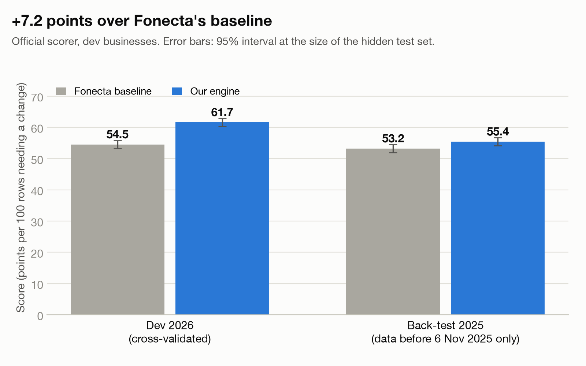

# Connect Suggests

**Team Connect · Fonecta's challenge “Connect Suggests – Customer Approves” · Since AI Hackathon 2026 (Turku, 6–8 Nov 2026)**

> Holiday hours go wrong because owners forget, and customers walk to a locked door. Fonecta asked for a working demo
> in which **Connect suggests and the customer approves**. We built the whole chain on the real Yext sandbox, and made
> it work for the owner who never answers.

| | Our engine | Fonecta baseline |
|---|---|---|
| **Score** (official scorer, dev 2026, business-grouped cross-validation) | **61.67** (95% CI 60.4–62.9) | 54.49 |
| Harmful suggestions (open/closed backwards) | 219 | 224 |
| Exact precision / recall | 0.859 / **0.670** | 0.901 / 0.590 |
| Closed-door lookups prevented | **72.9%** | 69.2% |
| Honest 2025 back-test (only data before 6 Nov 2025) | **55.42**, 211 harmful | 53.23, 249 harmful |
| New customers with no history (16 dev businesses) | **36.8** | 14.2 |

That's **+7.2 points** over the baseline (paired bootstrap 95% CI +6.3 to +8.1). `predictions_2026.csv` is in the repo
root. Charts are in [`docs/charts/`](docs/charts/).

**The trade-offs, said plainly:**
- **Precision.** Our precision is 86% against the baseline's 90%. That's a deliberate trade for **433 more exact fixes**.
- **Harmful suggestions.** 219 against 224 is within noise. On the 2025 back-test it's 211 against 249.

**Pitch deck:** [`deck/Connect_Suggests_pitch.pdf`](deck/Connect_Suggests_pitch.pdf) (also as `.pptx`).
**Supporting document:** [`deck/Connect_Suggests_supporting_document.pdf`](deck/Connect_Suggests_supporting_document.pdf),
which explains the how and the why behind every slide.

*Connect Suggests. It knows you're closed on Christmas before you tell it.*

## Everything for judging is in this repository

We've pushed every relevant part of the submission here:

| What | Where |
|---|---|
| **Predictions for the hidden test**: all 41,755 rows. Fonecta's own `evaluate.py` accepts every row and scores the dev rows at 61.67 | [`predictions_2026.csv`](predictions_2026.csv) |
| **The working app**: all five steps, no login, WhatsApp and email, writing to the real Yext sandbox | [`app/`](app/), [`cs/`](cs/) |
| **The prediction engine and its trained models** | [`cs/engine/`](cs/engine/), [`artifacts/models/`](artifacts/models/), [`scripts/train.py`](scripts/train.py) |
| **Every data finding and model result**, reproducible | [`notebooks/`](notebooks/), [`docs/ML_FINDINGS.md`](docs/ML_FINDINGS.md), [`docs/charts/`](docs/charts/) |
| **Every customer message as text** | [`docs/MESSAGES.md`](docs/MESSAGES.md) |
| **Pitch deck and supporting document** | [`deck/`](deck/) |
| **Tests**: 332 test functions, run with pytest | [`tests/`](tests/) |
| **The challenge dataset** (synthetic, CC BY 4.0) and the official scorer | [`dataset/`](dataset/) |

## Quick start

These commands check the score and open the app. The full guide, with every setting, is in
[§7 How to run it](#7-how-to-run-it).

```bash
git clone https://github.com/ayaanhussainsyed/Connect.git && cd Connect
python3.11 -m venv .venv && .venv/bin/pip install -r requirements.txt
unzip -q dataset/FONECTA_CONNECT_SUGGESTS_2026.zip -d dataset/

# 1. Score the submitted predictions with Fonecta's own scorer (no keys needed) -> Score: 61.67
.venv/bin/python dataset/FONECTA_CONNECT_SUGGESTS_2026/evaluation/evaluate.py --predictions predictions_2026.csv

# 2. Run the app. It needs MONGODB_URI in .env; Yext, Claude, WhatsApp and email keys are optional.
cp .env.example .env
.venv/bin/python scripts/run_mock.py                        # terminal 1: a local Yext mock
.venv/bin/python -m flask --app app.app run --port 5050     # terminal 2: open http://127.0.0.1:5050
```

Without keys, messages appear on the on-screen phone instead of a real one, and Claude's parts fall back to rules.
The predictions and the score don't need any keys.

---

## Contents
1. [The problem statement](#1-the-problem-statement)
2. [What the data told us (the problem behind the problem)](#2-what-the-data-told-us)
3. [What we built: the compulsory chain (Part A)](#3-what-we-built-the-compulsory-chain-part-a)
4. [What we built beyond it: innovation (Part B)](#4-innovation-part-b)
5. [Results](#5-results)
6. [Is the technology novel? Is it state of the art?](#6-is-the-technology-novel-is-it-state-of-the-art)
7. [How to run it](#7-how-to-run-it)
8. [How to test it](#8-how-to-test-it)
9. [Fonecta's README template sections](#9-fonectas-readme-template-sections)
10. [Rules we kept](#10-rules-we-kept)
11. [Project layout](#11-project-layout)
12. [Status: built, measured, and not finished](#12-status)
13. [Licences and attribution](#13-licences-and-attribution)

The full plan, with every decision, the research, three rounds of independent review and all measured corrections, is
in [`docs/PLAN.md`](docs/PLAN.md). The other documents:

| Document | What's in it |
|---|---|
| [`docs/APP_DESIGN.md`](docs/APP_DESIGN.md) | App design and user flows |
| [`docs/BUILD_PLAN_A.md`](docs/BUILD_PLAN_A.md) | Build plan for the compulsory chain |
| [`docs/ML_FINDINGS.md`](docs/ML_FINDINGS.md) | Every model finding, in plain words |
| [`notebooks/`](notebooks/) | Documented notebooks |
| [`docs/MESSAGES.md`](docs/MESSAGES.md) | Every customer message as text |
| [`docs/SETUP_LOG.md`](docs/SETUP_LOG.md) | What we measured on the Yext sandbox |

---

## 1. The problem statement

Fonecta Connect publishes a business's information (opening hours, photos, reviews) to 35+ channels such as Google,
Apple Maps, Bing and AI assistants. Today the owner has to log in, notice what needs doing, and type every change. Many
forget, especially one-off holiday hours, and search results then send customers to a closed door.

**The brief:** build a working demo of Connect contacting the customer, "Update your opening hours like this", across
the whole chain:

1. **Detect:** which data says the hours need to change?
2. **Suggest:** which hours, and why exactly those?
3. **Contact:** a message (email, SMS, WhatsApp…) with the suggestion and a clear reason.
4. **Decide:** approve, edit or decline, with no login.
5. **Apply:** write the change to Connect's backend (the Yext API), and tell the owner where it now shows.

**"A complete chain beats a perfect single step."**

**How it's judged:**
- **Suggestion quality:** a scoring script on hidden test data;
- **Customer experience;**
- **Reliability:** the customer always has the last word; wrong suggestions are prevented;
- **Extensibility;**
- **Learning:** better after an edit or decline, and standing permission.

**The dataset:** 3,000 synthetic businesses in Finland, Sweden and Norway, with three years of history. For every
business and every special day from 7 Nov 2026 to 6 Jan 2027 (41,755 rows), we decide one of:
- `SUGGEST` with hours;
- `NO_ACTION`;
- `FLAG` (for a person).

## 2. What the data told us

Before designing anything, we measured the problem. Every number is reproducible in
[`notebooks/01_data_and_models.ipynb`](notebooks/01_data_and_models.ipynb).

| Finding | Number | What it meant for the design |
|---|---|---|
| Holiday habits repeat | 92% of businesses keep the exact same hours on a holiday year to year (87% after 2 seasons, 81% after 3) | A business's own past is the strongest evidence; learned facts decay slowly (0.95 per season) |
| **"Copy last year" can't see half the problem** | Of the needed changes: 44% have last season's entry; **16% only have one from two seasons back; 36% only have other holidays entered** | Use two seasons back and the business's other holidays |
| Owner entries are accurate but biased | 99% match the truth, but owners enter 39% of special days against 2% of normal days | Train the open/closed model on true hours, not on entries (a trap many solutions fall into) |
| The provided peer file leaks the future | `peer_benchmarks.csv` pools 2023–2025, so it contains the answers in a 2025 back-test | We compute peer statistics ourselves, only from entries made before the snapshot |
| Closed doors are the main harm | 63% of needed changes are "shown open, actually closed" | Open/closed flips need the strongest evidence |
| **Silence is the real bottleneck** | In the 2025 pilot, **53% of suggestions got no reply** (52% of owners). Reply rate per suggestion: WhatsApp 65%, SMS 50%, email 40%, push 32% | Design for the owner who doesn't answer, not just for the one who does |
| Trust depends on the reason | Owners accepted 95% of suggestions based on their own history, but only 81% of peer-based ones | Lead with the owner's own history; phrase peer-based suggestions as a question |
| Apps update at very different speeds | Google ~2 min, Apple Maps ~2 days, **AI assistants and Foursquare ~7 days** (`listings.json`) | Every date gets an "answer by" deadline so every app shows it in time |

## 3. What we built: the compulsory chain (Part A)

All five steps run end to end on the **real Yext sandbox**. The sandbox entity `SinceAi04` was renamed to our demo café
*Kahvila Aurora*, so what we detect is what we write. A full run takes about 28 seconds:

```
1 DETECT   what Google shows now for every business and date (matches Fonecta's labels on 100% of 22,218 rows)
2 SUGGEST  the ML engine predicts the true hours; a decision rule keeps only suggestions worth sending; guardrails; FLAG for closed-for-good
3 CONTACT  one season card per business in fi/sv/nb/en, on the owner's channel, with an "answer by" date and the reason
4 DECIDE   no login: WhatsApp buttons, SMS digits, signed one-tap links, or free text ("kiinni tapaninpäivänä" = closed on Boxing Day)
5 APPLY    Yext write that never touches weekly hours, re-reads first so the owner's own changes win, reads back, confirms where it shows
```

| ID | Feature | How |
|---|---|---|
| A1 | **What Google shows now** | `cs/display.py`. It reproduces Fonecta's displayed hours on 100% of dev rows (11,100/11,100) and the back-test (11,118/11,118). Fonecta's own sample code (`examples/baseline.py`) gets **86** of the 2026 dev rows wrong. We fix the four cases it gets wrong: closed-for-good timing, entries made on the snapshot day, versions effective on the snapshot day, and seasonal reopening restoring the earlier hours |
| A2 | Days to check | The targets file. A live calendar reproduces it exactly (bonus) |
| A3 | Suggestions with reasons | `cs/suggest/`. Every suggestion carries evidence with dataset references; it's exported to the database and `predictions_2026.csv` |
| A4 | **Preventing wrong suggestions** | Calibrated probabilities, then the action with the best expected points under the scorer's exact table (FLAG included), with a tuned extra margin for open↔closed flips. Plus unit-tested guardrails: never contradict an owner's entry; never past dates; valid hours only; no messages to opted-out owners; no suggestions to listings closed for good |
| A5 | Closed for good → a human | `cs/engine/flags.py`. Closure reviews and "closed" user edits; analytics alone never count |
| A6 | Stay quiet when it's already right | A result of A4. NO-D0015 gets no message. FI-D0013 gets only the one question: the model is unsure about New Year's Eve, and asking is worth +0.61 expected points |
| A7 | **The message** | `cs/compose.py`. Four languages, local date formats, channel limits (WhatsApp body ≤ 1,024, buttons ≤ 20 chars), an AI disclosure on first contact (EU AI Act Art. 50). Every fact is filled from data, and a test checks every date and time against the suggestion |
| A8 | **No-login decision** | `cs/links.py`. HMAC-signed, expiring, single-use links. **Opening a link never decides anything**, so email link scanners can't approve by accident. WhatsApp and SMS webhooks; free-text replies read by Claude, with a rule-based fallback and a read-back before saving |
| A9 | **Apply and confirm** | `cs/yext.py`. Writes only `holidayHours`, so weekly hours are never touched; always sends the full future list (Yext deletes any date left out); drops past dates; **re-reads before writing, so the owner's own change wins**; reads back; confirms per publisher ("Google ~2 min · Apple Maps ~2 days · AI assistants ~7 days · Facebook: not connected") |
| A10 | Guardrails and audit trail | A hash-chained, tamper-evident audit log in MongoDB for every suggestion, message, decision and write |
| A11 | **Learning and standing permission** | Answers become learned facts: the newest wins, and they age by 0.95 per season. "Approve + every year" becomes a scoped, revocable permission; edits update it and undo revokes it. Measured: +1.3 points with last year's feedback |
| A12 | No history | Peer priors, cautious limits, and one well-chosen question. 36.8 vs 14.2 |
| A13 | **The whole profile, not just hours** | Weekly hours that changed (`cs/profile/drift.py`; precision 1.00) and drafted replies to "it was closed" reviews (`cs/profile/review_reply.py`), through the same loop |

## 4. Innovation (Part B)

**Our premise: every strong team will build "suggest, then approve".** So Part B targets the problems inside the brief
that the straightforward loop doesn't solve.

| Problem inside the brief | What we built | Measured / status |
|---|---|---|
| **More than half of owners never answer** (pilot: 53% of suggestions got no reply), so "suggest + approve" doesn't reach them | **★ Season Autopilot:** one pre-filled card per season with two equal buttons, **Approve** and **Approve + every year**, plus a one-sentence scope. Next season the agreed hours are applied ≥ 14 days ahead and the owner gets a note with an undo. **It only applies a learned fact if this year's model agrees (P ≥ 0.5); otherwise it asks** | Blind re-application gets open/closed wrong 10.1% of the time; with the agreement check, **3.5%** (95% exact). Coverage of next season's at-risk lookups at a 12% grant rate: 38.0% vs 33.8% with the card alone (44.4% at 30%, 51.6% at 50%). The grant rates are assumptions; Fonecta's simulator can't measure button design, so that's an A/B test for production |
| Owners need to answer **in time for every app** | **Per-publisher deadlines:** "Answer by 17.12 so AI assistants show it on 24.12", from each publisher's update speed | Built into every card |
| **Uncertain dates:** guessing risks a wrong flip, staying silent misses a fix | **One smart question:** the date where an answer gains the most expected points (value of information over the model) | +0.50 points per business vs +0.09 for a random date (150 businesses; the app asks about the best date *not already on the card*, so a question never repeats a suggestion). Honestly: the gain comes from *choosing* the date; the answer barely moves other dates |
| **"Copy last year" misses half the changes** | The score engine: an exact rebuild of what each app shows, two seasons back (worth +5.9 points on its own), training on true hours instead of biased entries, leak-free peer statistics, and a calibrated decision rule with a safety margin | +7.2 points, fewer harmful (§5) |
| **Unplanned closures** (illness, a burst pipe), the brief's locked door, which planned-holiday tools miss | **"Closed today":** the owner texts "kiinni tänään" or taps a button. It's live on Google within minutes, ends by itself, and **the reason is never stored** (GDPR: health data). Long closures use Yext `reopenDate` | Built and tested |
| **Nobody else should overwrite the owner** | **The owner always wins:** a re-read before every write cancels our change if the owner changed that date meanwhile | Built and tested on the sandbox |
| **"Why?" must never be invented** | Evidence stored with every suggestion; **Ask Connect (Graph RAG):** a per-business knowledge graph in MongoDB. Claude answers only from retrieved facts, with a citation on every sentence, and a check rejects any date or time not in the facts | Built: the owner asks in the message thread or on the card page; see the examples below |
| **Extensibility** | One `Suggestion` loop for weekly-hours drift, review replies, closed-for-good, emergencies and autopilot | Built |

**Ask Connect examples**, live Claude answers with their citations:
- *"Is the shopping centre open on 26.12?"* → "Yes, the shopping centre entered 11:00–17:00 for 26.12.2026 (Boxing
  Day) on 22.10.2026 [holiday_hours_history:FI-M000:2026-12-26] … your listing currently shows 10:00–18:00 for that day
  … Connect suggests 11:00–17:00 (88% confidence) [engine:FI-D0004:2026-12-26]."
- *"Mitä tein viime pääsiäisenä?"* ("What did I do last Easter?") → "Viime pääsiäisenä merkitsit pitkäperjantain
  3.4.2026 suljetuksi … [holiday_hours_history:FI-D0001:2026-04-03]." That is: "Last Easter you marked Good Friday
  3.4.2026 as closed."

## 5. Results

Every number comes from Fonecta's own `evaluate.py`, or from scripts in this repo.

| | Score | Harmful | Exact precision | Recall | Search views protected | Closed-door views prevented |
|---|---|---|---|---|---|---|
| **Our engine, dev 2026** (grouped CV) | **61.67** | **219** | 0.859 | 0.670 | 65.0% | 72.9% |
| Fonecta baseline, dev 2026 | 54.49 | 224 | 0.901 | 0.590 | 57.2% | 69.2% |
| **Our engine, 2025 back-test** | **55.42** | **211** | 0.866 | 0.597 | 56.3% | 66.2% |
| Fonecta baseline, 2025 back-test | 53.23 | 249 | 0.899 | 0.578 | 55.1% | 67.7% |

- **How the dev number was produced.** Every dev business is predicted by models that never saw it. The calibration and
  safety margin are chosen on other businesses. Re-running the scorer on `predictions_2026.csv` gives exactly 61.67 / 219.
- **Honest caveats:**
  - The harmful-suggestion interval at test size (200–239) overlaps the baseline's 224.
  - On the back-test we prevent slightly fewer closed-door lookups (66.2% vs 67.7%), while fixing more lookups overall
    and making far fewer harmful suggestions.
- **Beyond the scored rows:**
  - **Learning:** 58.3 → 59.6 with last year's answers (pilot owners); harmful 79 → 75 → 72 with declines.
  - **Weekly-hours drift:** precision 1.00, recall 0.55. All 12 proposed weeks are exactly right.
  - **Closed for good:** 1 of 2 hidden closures flagged, with no false flags.



The other charts:
- [harmful](docs/charts/b_harmful_vs_baseline.png);
- [closed-door lookups](docs/charts/c_closed_door_views.png);
- [learning](docs/charts/d_learning_feedback.png);
- [no history](docs/charts/e_no_history.png);
- [Season Autopilot coverage](docs/charts/f_autopilot_coverage.png).

## 6. Is the technology novel? Is it state of the art?

**Short answer:** the *algorithms* are established and deliberately so. What's new is how they're combined for this
problem, plus several product mechanisms we haven't seen in listings tools. We don't claim new ML research.

**What is state of the art and appropriate here:**
- **Gradient-boosted trees for tabular data:** scikit-learn `HistGradientBoostingClassifier`. Boosted trees remain the
  strongest general choice for tabular problems of this size; deep tabular models and foundation models such as TabPFN
  were considered, but aren't needed for 3,000 businesses and are harder to explain.
- **Calibrated probabilities** (isotonic regression), then **decision-theoretic action selection.** We choose the
  action that maximises *expected points under the exact scoring table* (FLAG included), instead of a hand-set
  confidence threshold. The extra safety margin for flips is tuned by cross-validation.
- **Rigorous evaluation:** business-grouped cross-validation (no business is scored by a model that saw it); time-
  respecting features (a unit test proves features don't change when post-snapshot data is deleted); an honest back-test;
  bootstrap confidence intervals; and ablations of every signal, reporting what *didn't* help.
- **A latent-class habit model** (EM mixture, number of types chosen by held-out likelihood) and **value of
  information** for choosing the one question. Both are classic, principled methods.
- **LLMs, used where language is the problem:**
  - Claude Opus 5 parses free-text replies (the analysis is written first, the strict JSON last) and polishes wording
    under a **slot check**, so facts can't drift.
  - Facts always come from data.
  - **Graph RAG:** retrieval follows typed edges, not embeddings; answers must cite a fact for every sentence, and a
    verifier rejects any unsupported date, time or number.
  - An OpenAI-compatible key (GPT-6 Astra) can be configured, but nothing in the app or the score calls it.

**What is novel, as far as we found:**
1. **Earned, scoped standing permission with a model-agreement check:** auto-apply only what the owner agreed to *and*
   this year's model still believes; otherwise ask. It turns a 10.1% error rate into 3.5%.
2. **Per-publisher answer-by deadlines** derived from each app's update speed.
3. **Asking only the single most valuable question,** measured by expected points.
4. **Owner-wins concurrency:** re-read before every write, so an owner's own edit is never overwritten.
5. **Fixing traps in the challenge data itself:** biased entry labels and a leaking peer file. Plus a display engine
   more correct than the provided baseline.

**What we found that *didn't* help, and say so:**
- the habit model adds no points to the score;
- linked holidays add no measurable points either (62.05 without them, against 61.67 with). What does help is
  everything from the business's other holidays taken together (−1.3 points without it);
- peers, reviews, user edits and events add nothing on top of own history;
- blind autopilot is unsafe.

## 7. How to run it

**Requirements:**
- Python 3.11;
- the challenge dataset: the zip is included in `dataset/` (synthetic, CC BY 4.0);
- optional: a MongoDB Atlas connection (for the app), the Yext sandbox key, and LLM keys. The score engine needs none
  of them.

```bash
git clone <this repo> connect && cd connect
python3 -m venv .venv
.venv/bin/pip install -r requirements.txt          # exact versions: requirements.lock.txt

# Dataset (included in this repo; synthetic, CC BY 4.0). Unzip it once:
unzip -q dataset/FONECTA_CONNECT_SUGGESTS_2026.zip -d dataset/    # creates dataset/FONECTA_CONNECT_SUGGESTS_2026/

cp .env.example .env    # then fill in what you need (below)
```

**`.env` settings:**

| Setting | Needed for |
|---|---|
| `DATASET_DIR` | Always (default `dataset/FONECTA_CONNECT_SUGGESTS_2026`) |
| `MONGODB_URI`, `MONGODB_DB` | The app, the audit log, the knowledge graph |
| `LINK_SECRET`, `PUBLIC_BASE_URL` | Signed no-login links (e.g. `http://127.0.0.1:5050`) |
| `YEXT_SANDBOX_KEY`, `YEXT_SANDBOX_ENTITY_ID` | Writing to the real Yext sandbox |
| `OPENAI_BASE_URL`, `OPENAI_API_KEY`, `OPENAI_MODEL` | Optional. Not called by the app or the score |
| `ANTHROPIC_FOUNDRY_BASE_URL`, `ANTHROPIC_FOUNDRY_API_KEY`, `CLAUDE_MODEL`, `CLAUDE_FAST_MODEL` | Claude via Microsoft Foundry |
| `LLM_ENABLED=0` | Run everything without LLMs |
| `WHATSAPP_*`, `SMTP_*` | Real message delivery. Otherwise messages go to the on-screen outbox. The template is in [`docs/WHATSAPP_TEMPLATE.md`](docs/WHATSAPP_TEMPLATE.md) |

**Score the submitted predictions** (no keys needed):
```bash
.venv/bin/python dataset/FONECTA_CONNECT_SUGGESTS_2026/evaluation/evaluate.py --predictions predictions_2026.csv
```

**Retrain the engine** (about 6 min on a laptop, CPU only). The trained models are already in `artifacts/models/`:
```bash
.venv/bin/python scripts/train.py --refresh --backtest
.venv/bin/python scripts/eval_ablations.py      # optional, ~20 min
.venv/bin/python scripts/eval_question.py
.venv/bin/python scripts/eval_drift.py
.venv/bin/python scripts/eval_autopilot.py
```

**Export suggestions** to the database and CSV:
```bash
.venv/bin/python scripts/predict.py --engine ml     # or --engine baseline; add --no-mongo to skip the database
```

**The five steps in the terminal:**
```bash
.venv/bin/python scripts/demo.py FI-D0001 --target sandbox   # the real Yext sandbox; cleans up afterwards (--keep to keep)
.venv/bin/python scripts/run_mock.py                         # in another terminal, for --target mock and the owner simulator
.venv/bin/python scripts/demo.py FI-D0001 --target mock
```

**The web app:**
```bash
.venv/bin/python scripts/run_mock.py                           # terminal 1: Fonecta's local Yext mock (temp state)
.venv/bin/python -m flask --app app.app run --port 5050        # terminal 2, then open http://127.0.0.1:5050
```

The interface is deliberately plain: white background, black text, one primary button per screen, Lora headings
and Inter for body text. While Connect works, each screen lists the steps it is running.

**Try it as an owner** (http://127.0.0.1:5050 → *Start as a business owner*). You become the owner of any of the
3,017 businesses and live through a season. Connect does everything on its own schedule; **Next** only moves time
forward (in production a daily job does that, `scripts/tick.py`):

1. **Join** (`/start`): pick your business and how Connect reaches you (WhatsApp or email; one channel only). Real WhatsApp messages go to a test phone, and taps or replies made on that phone come back through Meta's signed webhook and show on the page within seconds.
2. **Welcome, on that channel** (onboarding, `cs/onboarding.py`): "On public holidays you're usually: Closed / Shorter
   hours / Open as normal", then "every year?". The answers become Connect's memory.
3. **1 December:** Connect checks your listing and sends **one** card. *Why Connect thinks so* shows the evidence and
   the engine's confidence for each date ("91% of similar businesses nearby were closed", "you told us when you joined").
   Answer on your phone; **your listing on Google** updates beside it.
4. **12 December, life happens:** "closed today", a question for Ask Connect, weekly hours that changed, a reply to an
   "it was closed" review.
5. **November 2027:** Connect remembers: Autopilot if you said "every year", otherwise a card that says "as you told us".
6. **Connect's memory** (`/me/memory`, on every day): the business's knowledge graph, with the trained models'
   predictions on every special day, the owner's remembered answers and their decisions. Click a day to see how next
   season decides it: the owner's answer is applied by itself only if this year's model gives it at least 50%.
   Otherwise Connect asks first.

A strip of dates at the top lets you go back to any day you've already reached. Every step shows what Connect is doing
while it works: the nightly predictions, the read from Yext, Claude reading a reply, the write and the read-back.
6. **Your year with Connect:** days fixed, customer lookups that saw the right hours, messages, replies.

| Page | What it shows |
|---|---|
| `/`, `/start`, `/me` | The owner experience above |
| `/c/<token>` | The owner's no-login card (from the message link): one "Approve these hours" button, an "every year" checkbox, and quiet links for *Change a day*, *No thanks*, *Closed today?* and *Ask a question*. After approving: where it shows, Undo, and the offer to reply to customers who found the door closed |
| `/how` | How Connect decides: the five steps, the engine, the safety rules and the measured results |
| `/businesses`, `/b/<id>` | For Fonecta staff: every business grouped by what Connect will do this season (needs the owner's OK / Autopilot / flagged / already right), and one business's plan with its next action |
| `/ops` | For Fonecta staff: businesses flagged for a person, every card and its status, the audit log and "Verify" |
| `/suggest`, `/a1` | For Fonecta staff: every suggestion with evidence, confidence and safety rules; what Google shows on a day, and why |

**Real delivery:** WhatsApp goes to `WHATSAPP_TEST_TO` (Meta's test number only reaches allow-listed phones; send it
any message first, and `WHATSAPP_ASSUME_SESSION=1` lets the full card go out before the templates are approved); email
goes to `SMTP_TEST_TO`. Every message also appears on the on-screen phone. SMS stays on screen (Finnish operators block
unregistered senders).

**Command-line tools:**
```bash
.venv/bin/python -m cs.display FI-D0001 2026-12-24                       # what Google shows, and why
.venv/bin/python -m cs.compose FI-D0001 --lang fi --channel WHATSAPP      # the season card message
.venv/bin/python -m cs.llm parse "kiinni tapaninpäivänä, muuten ok" --dates 2026-12-24,2026-12-25,2026-12-26
.venv/bin/python -m cs.yext show FI-D0001 --target sandbox                # also: set / clear / set-regular / remove / reopen
.venv/bin/python -m cs.profile drift SE-D0016 --lang sv                   # "your weekly hours changed"
.venv/bin/python -m cs.profile reviews FI-D0012 --lang fi --no-db         # a reply to a closed-door review
.venv/bin/python -m cs.kg ask FI-D0004 "Is the shopping centre open on 26.12?" --lang en   # Ask Connect (Graph RAG)
.venv/bin/python -m cs.live.calendar                                      # bonus: the live calendar agreement report
```

## 8. How to test it

```bash
.venv/bin/pytest -q -m "not mongo and not network and not sandbox"   # 461 offline tests, ~15 s
.venv/bin/pytest -q                                                  # all 537 (needs MongoDB; ~5 min)
.venv/bin/pytest -q -m network                                       # live LLM tests
.venv/bin/pytest -m sandbox tests/test_yext_sandbox.py               # opt-in: writes to the Yext sandbox, then restores it
```

**What the tests cover:**
- the display engine against all 22,218 labels;
- our scorer mirror against `evaluate.py`;
- every guardrail;
- token expiry, reuse and tampering, and "GET never decides";
- Yext merge, past-date and owner-wins behaviour;
- message slots in four languages and channel limits;
- emergency auto-expiry, spoofed senders and "no reason stored";
- autopilot scope and the agreement rule;
- learned-fact superseding;
- audit chain verification;
- the Graph RAG checker rejecting invented times;
- no leakage in the ML features.

Database tests use a throwaway `connect_suggests_test_*` database that's dropped afterwards.

## 9. Fonecta's README template sections

**The five steps:**
1. **Detect:** what Google shows now (`cs/display.py`) for every target day, compared with the engine's prediction of
   the true hours.
2. **Suggest:** calibrated hours, with evidence and the expected-points decision; closed-for-good goes to `FLAG`.
3. **Contact:** one season card per business in its language and on its channel, with an answer-by date and the reason.
4. **Decide:** WhatsApp buttons, SMS digits, a signed one-tap link or free text. No login, and nothing is applied
   without a decision or scoped permission.
5. **Apply and confirm:** a Yext write that keeps weekly hours, owner-wins, a read-back, and a per-publisher
   confirmation.

**Data sources that mattered most**, each measured by removing it and re-running the full pipeline:

| Signal | How we used it | Worth (measured) | Where Connect would get it in production |
|---|---|---|---|
| The business's own past entries for the same holiday | The strongest evidence for state and hours | Without own history: 61.7 → **33.4** | Connect's audit log of entered holiday hours (Yext `holidayHours` history) |
| The entry from two seasons back | Covers years the owner didn't enter | **−5.9 points** without it | The same log, kept ≥ 3 seasons |
| The business's other holidays | Summaries of how the owner handled their other holidays (closed on Christmas Day → closed on New Year's Day 89% vs 36%). Linked-holiday features alone add nothing measurable | −1.3 points without all of it together | The same log |
| Owners' past decisions (2025 pilot) | Answers become history; declines are never repeated | 58.3 → 59.6; harmful 79 → 72 | Connect's suggestion and decision log |
| The shopping centre's hours | Candidate hours for tenants | Small (−0.15) | Centre integrations or websites |

Plus **what Google shows now** (100% match; production: the Yext Entities API) and **reviews stating new weekly hours**
(the drift detector; production: Yext Reviews).

**What we tried that didn't work:**
- **The habit-type model** (EM, 10 types): +0.2, within noise. Kept for explanations, and as a modest helper for the question.
- **Peers, reviews, map-user edits and events** on top of own history: within noise.
- **`peer_benchmarks.csv`:** leaks the future in a back-test, so it's never used.
- **Analytics as a closure signal:** none of the 8 collapses were real closures.
- **Blind "every year" autopilot:** 10.1% wrong open/closed, hence the model-agreement check.
- **Drift from map-user edits alone:** never confident enough to message an owner.
- **Company-register matching:** the businesses are synthetic, and registers hold no opening hours.
- **Bigger models:** more suggestions, more harm, no gain.

**Customer with no history** (`FI-D0017`, Kahvila Kipinä, joined 12 Oct 2026):
- It starts from what similar businesses do and suggests only what's near-certain: New Year's Day closed, 80%.
- It stays quiet on the other 13 dates.
- It asks **one** question, the date worth the most expected points.
- On the 16 dev businesses with truly no entries, it scores 36.8 vs the baseline's 14.2, mostly by not guessing.

**Final customer messages:** all of them, as text, are in [`docs/MESSAGES.md`](docs/MESSAGES.md). That covers:
- season cards in fi/sv/nb/en and SMS;
- the approve, every-year, edit read-back, decline and reminder follow-ups;
- the confirmation;
- "Closed today";
- the autopilot note;
- a weekly-hours drift message;
- a review reply.

Example (Finnish, WhatsApp, first contact):
```
Connect Suggests · automaattinen avustaja
Hei Kahvila Aurora! Joulun ja uudenvuoden aukioloajat – ehdotuksemme:
• to 24.12. 7.30–13 (viime vuonna sama)
• pe 25.12. kiinni (viime vuonna sama)
• pe 1.1. kiinni (viime vuonna sama)
• ke 6.1. 10–16 (kuten 2 vuotta sitten)
Jos et tee mitään, Google näyttää näinä päivinä: 7.30–18
Vastaa viimeistään to 17.12., jotta myös tekoälyavustajat ehtivät näyttää ajat oikein.
Viime joulupäivänä ~50 ihmistä haki teitä.
"Joka vuosi" = samat päivät samoin ajoin jatkossakin; uudet asiat kysymme aina. Voit perua milloin vain.
  [Hyväksy]  [Hyväksy + joka vuosi]  [Muokkaa]
```

**Bonus: live sources.**
- **The special-day calendar, live** (`cs/live/calendar.py`). The `holidays` package (MIT), with the Nager.Date API as
  fallback, plus our own rules for eves, between-holiday days, Lucia, Black Friday, Father's Day and Mother's Day.
  - **Coverage:** all 244 dataset calendar rows reproduced (0 missing, 0 extra), and all 41,032 calendar target rows
    rebuilt exactly, so the score is unchanged.
  - **Quality:** Nager.Date lists 4 customary days as official holidays (Swedish Midsummer Eve, Christmas Eve and New
    Year's Eve, and Norwegian Christmas Eve).
  - **Gaps:** public-holiday sources stop at public holidays; eves and commercial days need rules; school breaks vary
    by municipality.
- **The Yext sandbox, read and written live:**
  - **What we measured:**
    - a sent `holidayHours` list replaces the stored one, a left-out key keeps it, and `[]` clears it;
    - past dates are silently dropped;
    - single-weekday and `reopenDate` patches work.
  - **Gaps:**
    - Listings, Reviews and Posts are empty for sandbox entities;
    - Analytics and Knowledge Graph Suggestions return 403;
    - **the local mock behaves differently** (it needs the full `hours` object), and our client handles both.

  Details: [`docs/SETUP_LOG.md`](docs/SETUP_LOG.md).

## 10. Rules we kept

| Rule | How |
|---|---|
| The owner has the last word | Nothing is written without a decision or a scoped permission; undo on every change; the owner wins on conflicts |
| Respect contact preferences | Preferred channel; opted-out owners get no messages (their rows stay in the CSV) |
| Audit trail | A hash-chained audit log; every suggestion keeps its evidence |
| Yext as backend | Every write goes through Yext Management API calls. No custom fields (as Fonecta advised); our own records live in MongoDB |
| Keys out of the repo and videos | `.env` is gitignored; `.env.example` only |
| No GPL/AGPL | See §13 |
| Honest back-test | Time-filtered features; a leakage test; no pooled peer file |
| Synthetic data only, privacy | No personal data. Emergency reasons are never stored; review author names are never stored; no names or contacts are sent to LLMs; the outbox keeps message text for 30 days |

## 11. Project layout

| Path | What it holds |
|---|---|
| `cs/display.py` | A1: what Google shows now |
| `cs/suggest/`, `cs/guardrails.py`, `cs/export.py` | A3–A6: suggestions, guardrails, CSV and database export |
| `cs/engine/` | The ML engine: features, habits (M1), state model, ranker, decision, flags, drift, question value |
| `cs/compose.py`, `cs/channels/`, `cs/llm.py` | Messages, channels (WhatsApp, SMS, email, outbox), LLM parsing and polish |
| `cs/links.py`, `cs/season.py`, `cs/decide_flow.py`, `cs/learn.py` | No-login links, season cards, decisions, learned facts and permissions |
| `cs/yext.py`, `cs/confirm.py` | The Yext writer (owner-wins) and "where it shows" |
| `cs/emergency.py`, `cs/autopilot.py` | "Closed today", and Season Autopilot |
| `cs/profile/` | Weekly-hours drift and review replies |
| `cs/kg/` | Ask Connect: the business knowledge graph and grounded answers |
| `cs/live/` | The live calendar (bonus) |
| `cs/audit.py`, `cs/db.py`, `cs/config.py`, `cs/data.py`, `cs/hours.py`, `cs/domain.py` | Foundations |
| `app/` | The Flask web app: owner pages, demo, ops, webhooks |
| `scripts/` | train, predict, back-test, evaluations, demo, mock, `gen_messages` |
| `notebooks/` | `01_data_and_models` (analysis and models), `02_results_for_pitch` (charts) |
| `artifacts/models/`, `artifacts/predictions/` | Trained models and engine outputs (retrain with `scripts/train.py`) |
| `tests/` | 537 tests |
| `docs/` | The plan, design, findings, messages, setup log, charts |

## 12. Status

**Built, tested and measured:**
- every Part A feature (A1–A13);
- Season Autopilot, including the agreement rule and FI-D0012's existing permission;
- per-publisher deadlines;
- the one question;
- "Closed today";
- owner-wins;
- weekly-hours drift;
- review replies;
- Ask Connect (Graph RAG);
- the live calendar.

**In the web app:** weekly-hours drift, review replies and Ask Connect are in the owner's conversation
(`cs/profile_flow.py`): the console's Check sends the weekly-hours question, the owner approves it with one tap
(owner-wins re-read, then the Yext write); after hours are set, Connect offers to reply to customers who found the door
closed; a question that starts with why/what/when (in any of the four languages) is answered from the business's own
graph, with its sources. A "no" is final: an answered offer is never sent again.

**Not finished, at the time of writing:**
- **The batch prediction models don't read learned facts.** Owners' answers do shape next season's card in the app
  ("as you told us", Autopilot and its agreement check), but the stored predictions come from the nightly batch. The
  effect of learning on the score is measured offline instead (58.3 → 59.6).
- **No send-time planner.** Contact windows and reminder scheduling (B4) aren't built; the reminder message text exists.
- **The "season radar" chart for Fonecta's ops** (B9) isn't built.

**What a production launch would need:**
- Fonecta's own WhatsApp, SMS and email accounts (with an authorised sender ID under Traficom's rules);
- the real audit log and CRM feeds instead of dataset files;
- EU hosting;
- staff sign-in for `/ops`;
- one A/B test of the "every year" button.

## 13. Licences and attribution

- **Data:** "Connect Suggests simulator, Since AI ry 2026", **CC BY 4.0**. The dataset's code (mock API, `hours.py`,
  example client, scorer) is **MIT**; `cs/hours.py` keeps its notice.

| Component | Licence |
|---|---|
| Flask, Jinja2, Werkzeug, click, itsdangerous | BSD-3-Clause |
| HTMX (CDN) | BSD-2-Clause |
| Fonts: Inter, Lora, JetBrains Mono (Google Fonts) | SIL Open Font License 1.1 |
| pandas, NumPy, SciPy, scikit-learn, joblib | BSD-3-Clause |
| PyArrow | Apache-2.0 |
| Matplotlib | Matplotlib licence (PSF-based, BSD-compatible) |
| pymongo | Apache-2.0 |
| certifi | MPL-2.0 |
| python-dotenv, httpx | BSD-3-Clause |
| openai (SDK) | Apache-2.0 |
| anthropic (SDK) | MIT |
| Pillow | MIT-CMU (HPND) |
| `holidays` | MIT |
| JupyterLab, nbconvert | BSD-3-Clause |
| pytest | MIT |
| Nager.Date API (fallback) | Free public API |

**No GPL/AGPL components.**
